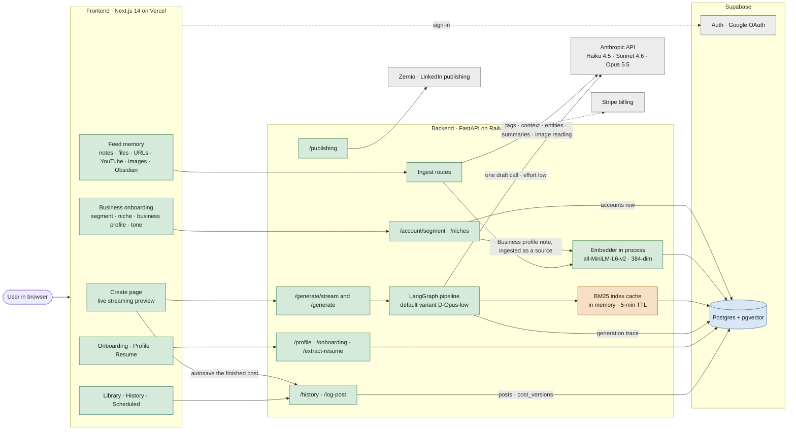
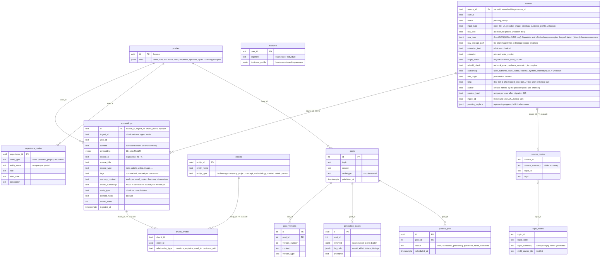
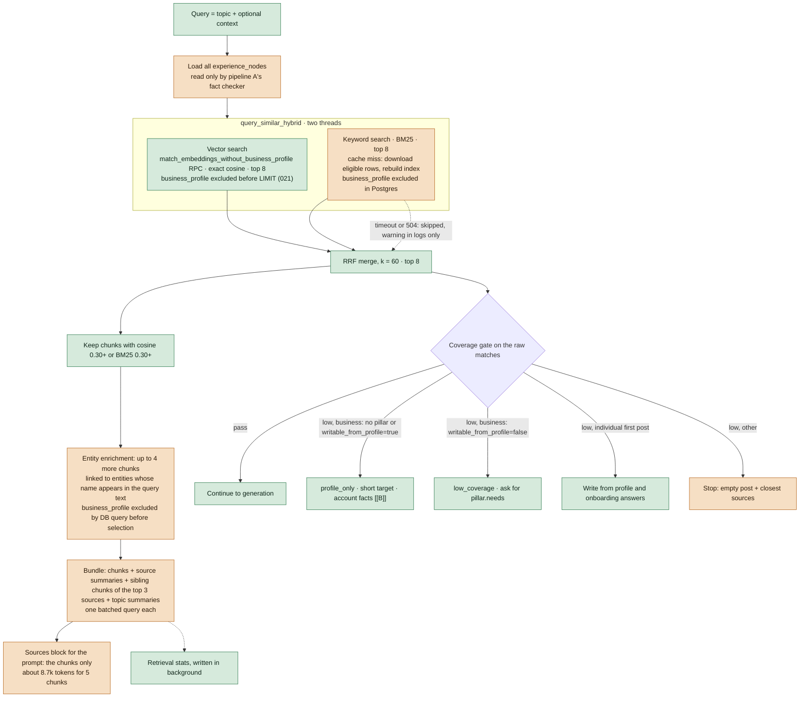
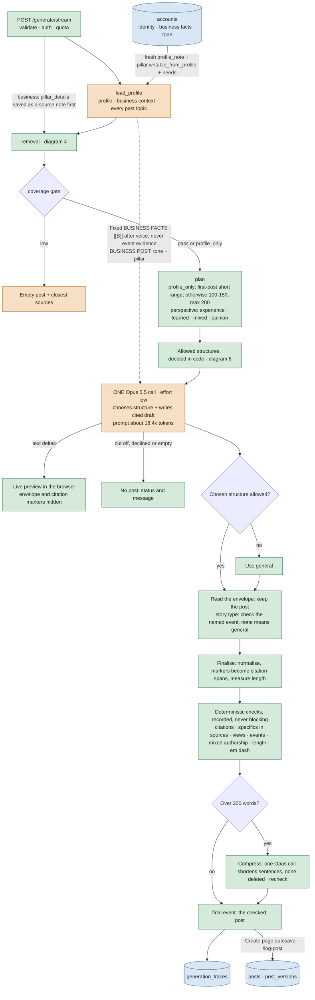
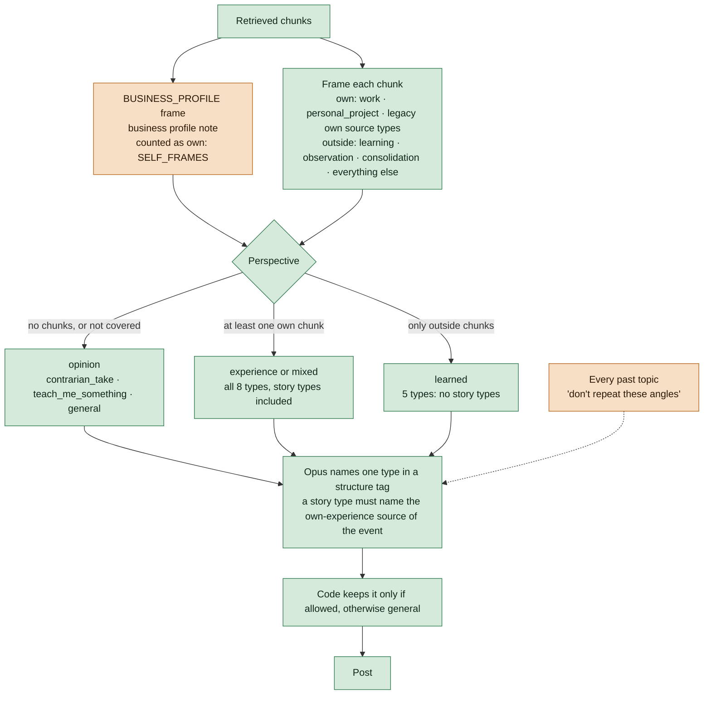
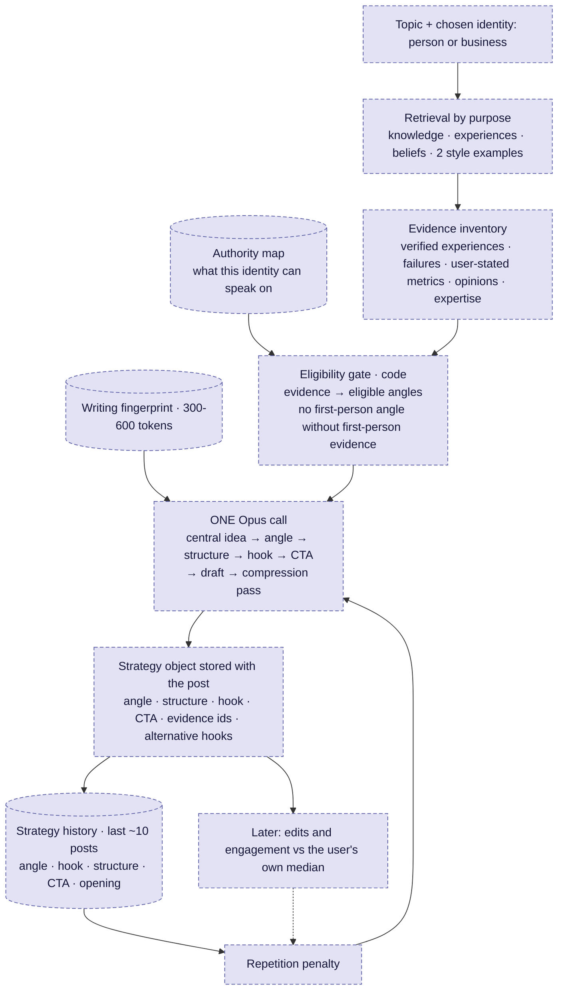
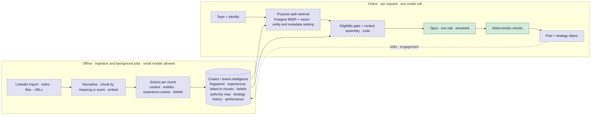
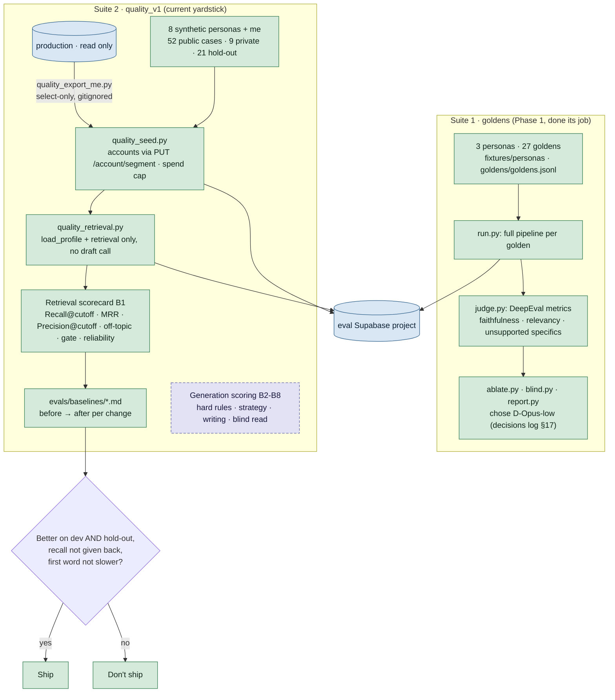

# Contendo architecture

Drawn from the code at commit `aa7f56c` plus the working changes on `feat/business-block`, 2026-10-16. **Update the affected diagram in the same PR as any change to ingestion, storage, retrieval or generation.**

Legend (flowcharts): green = built and working · orange = built, known issue · purple dashed = planned · blue = storage · grey = external service.

## 1. System overview

Every running piece and how requests move between them. Use it to answer "where does this happen?" before opening any file.

Notes:

- The BM25 keyword index lives in the backend's memory. On every cache miss it downloads the user's whole library from Supabase (see diagram 4). Supabase returns at most 1,000 rows per request (confirmed 2026-10-15 on a 1,101-row table, also with an explicit range) and the query doesn't paginate, so a library over 1,000 chunks is silently truncated. No production user is near it yet (largest library 149 chunks).
- Business users: `PUT /account/segment` saves the account row (niche, business profile, tone) and replaces the "Business profile" source note, built by `utils/business_notes.profile_note` and stored through the normal ingestion path.
- The embedding model runs inside the API process, so ingestion and generation share its CPU.
- The pipeline writes only the generation trace. The post itself and its versions are saved by the Create page's autosave (`POST /log-post`) after the final event arrives.

## 2. Data model and metadata

What is stored, in which table, with which metadata. Every content row is scoped by user_id. Tables for billing, usage events, retrieval stats, connected accounts and publishing approvals are left out to keep the picture readable.

Notes:

- memory_context is decided once per document, so every chunk of a mixed document (own notes plus a quoted article) gets the same label.
- experience_nodes come only from the profile form and resume extraction. They are not linked to the chunks that describe them, and hold roles and projects, not events (what happened, what was done, the outcome).
- topic_nodes.topic_summary is written as an empty string when a topic is created (`agents/ingestion_agent.py · _assign_to_topic`) and nothing fills it later.
- No table for beliefs or opinions (only a list inside profiles.data), authority per topic, identities beyond the account segment, or strategy history (posts.archetype holds the structure only; no angle, hook or CTA).
- `sources` is the record every derived row can be rebuilt from (migration 014). The 80 production sources (7 users, 2026-10-16) stored before it are `rebuilt_from_chunks`: text rebuilt from the chunks, line breaks lost, `raw_text` NULL, authorship NULL. Their files and images are gone; better extraction needs a re-upload.
- Nothing reads `sources.authorship` or `embeddings.chunk_authorship` yet: they are written only by the user, a rule (business profile form, pillar details, onboarding story → `user_stated`) or, later, the provenance classifier, and read only once that classifier is measured on quality_v1. The pipeline's existing self/external "authorship" is a different thing, derived from frames (`utils/frames.py authorship`).
- `sources` has no FK from embeddings because consolidation rows put an entity id in `source_id`. Identities (step 3, decision 4) add `identity_id` to `sources` when that table exists.
- Migration 016: deleting a chunk removes its `chunk_entities` links and deleting a `sources` row its `source_nodes` row (`ON DELETE CASCADE`). Since 017, a source's retrieval count goes the same way. Consolidation chunks, entities left without a chunk and topic children are cleaned up by `memory/derived_store.py` (diagram 3).
- Chunk ids are unique per ingest (`ingest_id`); chunks written before 016 keep `{source_id}_{chunk_index}`. Nothing parses an id.
- Tags are stored as comma text rather than an array. posts.user_id is a uuid while every other table stores user_id as text.
- Edits are kept as post_versions, but nothing records what kind of edit it was (hook rewritten, CTA removed).

## 3. Write path: adding content

What happens when a user adds anything to their memory. Steps after the chunk insert are wrapped so a failure never fails ingestion, which also means they fail with only a warning in the logs.

```mermaid
flowchart TD
  i1["Typed note or pasted text"] --> ic
  i2["File upload"] & i3["URL"] & i4["YouTube link"] & i5["Image"] --> dupk{"Same bytes or URL already stored?<br/>checked before any paid call"}
  dupk -->|"yes"| dupr["Duplicate, named: title · type · date added<br/>replaceable: user may resend with replace_source_id"]
  dupk -->|"no, or replace<br/>target: same file or URL, else same text"| ext["backend/extractors/<br/>file: pdfplumber headers/footers removed · DOCX headings, tables<br/>url: Jina JSON, title field, target status checked<br/>youtube: Supadata native in English · not English and ≤ 60 min: once from the audio · else refused<br/>title and channel from oEmbed · outcome cached from the preview<br/>image: Sonnet vision, text and description apart"]
  i6["Obsidian vault or zip"] --> ext
  ext -->|"structured text + SourceOriginal<br/>raw input · extractor and version"| ic["ingest_content"]
  ic --> chunk["Chunk: 500 words, 50 overlap"]
  chunk --> lang{"Language of the text<br/>py3langid on prose, ≥ 300 bytes and 0.9 confidence<br/>provider's code only when undetermined"}
  lang -->|"confidently not English"| langr["Refused before any model call or write<br/>422 naming the language"]
  lang -->|"English or undetermined<br/>stored as sources.lang"| dup{"content_hash already stored?"}
  dup -->|yes| skip["Duplicate, named and replaceable · no model calls<br/>a user Replace goes on: same source refreshed in place<br/>a text-matched Replace with other text: 409"]
  dup -->|no| tags["Sonnet: 3-8 tags for the whole document<br/>from its first 1,500 words"]
  tags --> ctxq{"valid memory_context chosen by user?"}
  ctxq -->|yes| one["One label for every chunk of the document"]
  ctxq -->|no| xref["Match against experience_nodes"]
  xref -->|"no match"| cls["Haiku classifier<br/>work · personal_project · learning · observation"]
  xref -->|match| one
  cls --> one
  one --> pend["New: sources row, status pending<br/>Replace: row claims pending_replace, old note stays live<br/>names the Storage path and ingest_id first"]
  pend --> srcT[("sources")]
  pend --> obj[("Storage source-originals<br/>file and image bytes")]
  pend --> emb["Embed each chunk · MiniLM<br/>ids unique per ingest_id"]
  emb --> rows[("embeddings rows")]
  rows --> ready["Commit: new row ready, or replaced row switches to the new set<br/>then the old set is deleted through the cascade<br/>failure before this: new row removed, or only the new set removed"]
  sweep["Sweeper: startup and hourly, over 30 min<br/>pending row → removed · replace → finished or undone"] -.-> srcT
  delp["Delete: Library (one source by source_id), admin, failed ingest, replaced chunk set"] --> casc["derived_store cascade<br/>chunks → links by FK · unlinked entities · affected consolidation chunks removed<br/>source_nodes and retrieval counts by FK · topic children · BM25 cache"]
  casc -.-> rows
  casc -.-> entT
  casc -.-> hier
  rows --> inval["Drop the user's BM25 cache"]
  rows --> ent["Haiku per chunk: up to 10 named entities"]
  ent --> entT[("entities + chunk_entities")]
  entT --> cons{"Entity now in 3 or more sources?"}
  cons -->|yes| consC["Haiku consolidation chunk"]
  consC --> rows2[("embeddings · node_type consolidation")]
  rows --> summ["Haiku: source summary"]
  summ --> topic["Assign topic: 2 or more shared tags, else new topic<br/>topic summary left empty"]
  topic --> hier[("source_nodes + topic_nodes")]
  resume["Profile form or resume upload"] -->|"Sonnet extraction, user confirms"| exp[("experience_nodes")]
  onbA["Individual onboarding answers"] --> prof[("profiles.data · accounts")]
  onbA -->|"first-post story as a personal_note"| ic
  bizA["Business onboarding<br/>niche · name · area · services · differentiators · customer · offers · tone"] --> acct[("accounts.business_profile")]
  bizA -->|"profile_note: every answer except tone<br/>source_type business_profile · memory_context work<br/>one sources row, replaced in place"| ic
  pdet["/generate with pillar_details"] -->|"details_note, titled by pillar"| ic
  class i1,i2,i3,i4,i5,i6,dupk,dupr,ext,ic,chunk,lang,langr,tags,emb,inval,ent,summ,consC,xref,skip,bizA,pdet,pend,ready,sweep,casc,delp built
  class one,cls,topic,hier issue
  class rows,rows2,entT,exp,prof,acct,srcT,obj store
  classDef built fill:#d6eadc,stroke:#2f7a4f,color:#10261a
  classDef issue fill:#f6dfc4,stroke:#b5651d,color:#2b1a08
  classDef planned fill:#e2e2f4,stroke:#5b5ea6,color:#16173a,stroke-dasharray:5 3
  classDef store fill:#d9e7f4,stroke:#2d5f8a,color:#0e2235
  classDef ext fill:#ececec,stroke:#6b6b6b,color:#1c1c1c
```

Notes:

- Classification is per document, not per chunk (orange). This is where a user's own XLR8 notes and an article about the same technology can end up indistinguishable.
- Nothing extracts experience events, beliefs or writing style from content as it arrives. Those are the spec's creator-intelligence items.
- LinkedIn profile import (Apify or Zernio) is not built yet.
- `source_nodes` and `topic_nodes` have 0 rows in production (2026-10-15) although 250 chunks exist (orange). The writes run after the chunk insert and fail with only a warning, so the cause isn't visible; step 2 audits it.
- Every ingest keeps its original (`memory/source_store.py`). The row is written before the Storage object and the chunks, so a crash can't leave anything without a record; the sweeper removes what a crash left pending.
- Every delete goes through one cascade (`memory/derived_store.py`, migration 016's foreign keys). A replace (the business profile note) writes a new chunk set before deleting the old one, so a failure partway keeps the old note; for those seconds retrieval can see both sets. Consolidation chunks of affected entities are removed, not rebuilt.
- The Library deletes one source by `source_id`; titles are not unique (one production library has 21 sources with no title).
- A duplicate is found by file or URL before extraction, or by exact text after it (sources saved before their URL was kept, such as videos stored as transcripts). Both answers name the match and offer Replace, which re-extracts into the same source even when the text is unchanged, so a better title, URL, channel or language can be written. A Replace that matched only by text must still have that text.
- Every source's text is identified before anything is paid for or stored (`utils/language.py`): the embedder is English-only, so a confidently non-English source is refused with its language named; short text is undetermined and accepted. Obsidian skips such a note; the business profile save reports `memory_saved: false`. A multilingual embedder is backlog, only if non-English users are supported.
- Business answers remain stored as a profile note for Library and rollback. With `BUSINESS_BLOCK_ENABLED=1` (default), the read path excludes it and generation builds the facts fresh from the account (diagram 5). Tone remains separate.

## 4. Read path: retrieval (the RAG part)

How sources are found for a topic. The vector and keyword searches run in parallel threads (each given 10 s) and are merged with reciprocal rank fusion.

Notes:

- Vector search is exact since migration 013 (2026-10-16). Before it, an IVFFlat index made it search about 1% of all rows, so it found almost none of a user's nearest chunks. Neither half searches source titles: the embedding and BM25 see only chunk text, so a topic that matches a title but not the body ("Nearshoring") scores near zero.
- Keyword search downloads the whole library on most requests (the 5-minute cache usually expires between posts), times out on large libraries, and may be capped at Supabase's 1,000-row default (not verified; depends on the project's PostgREST max rows setting). When it fails, posts get 1-2 sources instead of 5. Planned fix: exact BM25 inside Postgres with the same scores.
- Source summaries, sibling chunks and topic summaries are fetched (the `source_context` step, 0.25-1 s in production traces) but the D-Opus-low prompt shows only the chunks. They reach only `retrieved_context`, which is stored in the trace and read by nothing else. Topic summaries are always empty (diagram 2).
- Experience nodes are loaded on every request; under D-Opus-low nothing reads them.
- Entity enrichment matches entity names as substrings of the query (a 3-letter entity can match inside a longer word) and loads all of the user's entities on every request.
- Ranking is by relevance only. It doesn't know which sources are the user's own experience, which project the topic names, or recency, so outside articles can outrank the user's own notes.
- One pool of chunks for everything. The spec splits it by purpose: knowledge, experience, beliefs, style examples.
- Low coverage is a dead end. The spec replaces it with follow-up questions whose answers become citeable memories.

## 5. Generation pipeline (D-Opus-low, live default)

What happens after Generate is clicked. One Opus call chooses the structure and writes the cited draft; everything after it is deterministic code except the optional compress call.

Notes:

- `BUSINESS_BLOCK_ENABLED=0` restores the original retrieval RPC, BM25 corpus, gate and archetype behavior, and removes the facts block. Migration 021 must precede the backend deploy; rows are retained. BM25 caches rebuild when the flag changes.
- The account supplies business name and role at request time; stored voice descriptors and writing samples remain style references. Business identity is omitted from draft/refine voice blocks. `[[B]]` cites only the saved account facts, never an event source. Refine uses the original trace facts even with no retrieved chunks.
- Prompt is about 18.4k tokens against a target of about 2.3k: sources 8.7k, every past topic 3k (grows about 30 tokens per post), rules 2.7k, profile 1.7k, structure options 0.9k.
- Opus thinking varies from 0 to 840 tokens on the same prompt even at effort low, so time to first word varies from about 1.5 s to about 15 s (replay of 12 calls, 2026-10-15).
- Drafts run 164-209 words against the requested 100-150.
- Business users get the BUSINESS POST block (tone from `business_profile.tone` + `tone_notes`, and for a chosen pillar its `about` and `needs`) from `agents/draft_prompt.py _business_post`. The request's own `tone` (casual · technical · storytelling) is also applied, so a business post gets two tone instructions.
- Opus 5.5 rejects a request with thinking disabled at every effort, so effort is the only setting available.

## 6. How the post's angle is chosen: today

Today there is one decision, the structure type, made from whether any source is the user's own. There is no separate angle, hook or CTA choice, no authority check, and repetition is handled only by listing every past topic in the prompt.

Notes:

- The 8 types: incident_report, personal_story, before_after (story types, need an own event), contrarian_take, teach_me_something, list_that_isnt, prediction_bet, general.
- The frame comes from memory_context; chunks stored before memory_context existed are framed by source_type (`utils/frames.py · chunk_frame`).
- The perspective depends entirely on memory_context, which is set once per document (diagram 3). A wrong label at ingestion changes which structures are allowed.
- The business profile note has its own frame (facts may be stated; never add a listing, price, client or result) but counts as own experience. For a business user it is retrieved for most topics, so the perspective becomes experience or mixed and the story types are allowed even when no event is stored (orange).
- Missing compared with the spec: angle taxonomy (16 angles), hook strategy (10 types), authority map, beliefs, repetition by angle and hook, CTA choice by objective, writing fingerprint.

## 7. How the angle will be chosen: target

The spec's design. Evidence decides what is allowed (a hard gate in code), and Opus chooses within that, in the same single call. Purple dashed boxes are not built yet.

Notes:

- Angles: personal_story, contrarian_opinion, mistake_lesson, confession, unexpected_result, observation, how_to, framework, case_study, before_after, prediction, myth_busting, analysis, list, failure_to_realization, changed_my_mind.
- Hooks: contrarian, confession, mistake, unexpected_result, curiosity, specific_result, observation, question, story, direct_value.
- Weights for ranking eligible angles (evidence 0.30, topic 0.20, voice 0.15, objective 0.15, history 0.10, novelty 0.10, minus repetition) are starting guesses to tune with the evals, not settled values.

## 8. Target architecture and build order

Where the pieces above are heading, and the order agreed on 2026-10-15: quality before latency, built from the data layer up. Each step is scored against the multi-persona test set from step 1.

Notes:

- Step 1: quality definition and multi-persona test set, plus a read-only check of the keyword-search row limit.
- Step 2: read-only audit of the data layer, scored on the test set.
- Step 3: target data model, derived from what each quality criterion needs (experiences and projects linked to chunks, beliefs, authority, identities, strategy history). Keyword search moves into Postgres here if the row limit is confirmed earlier.
- Step 4: rebuild retrieval on it: by purpose, entity and metadata ranking.
- Step 5: generation quality: strategy object, hooks, retention chain, CTA, cold start.
- Step 6: latency, with the guardrail that no change makes the first word slower than today without a deliberate decision.

## 9. Evaluation: how changes are measured

Evals run the real backend code against a separate Supabase project (contendo-dev), never production. Two suites exist; the second is the yardstick for the build order in diagram 8. Commands and safety rules: `evals/README.md`. Criteria: `docs/QUALITY.md`.

Notes:

- Suite 2 found the vector-search bug (recall@8 0.03 in production) that production traces never showed; the before/after records are `evals/baselines/2026-10-15-quality-v1-retrieval.md` and `2026-10-16-exact-vector-search.md`.
- The two suites duplicate personas, loaders, seeders and report formats. Plan: when generation scoring (B2-B8) is built on quality_v1, move what Suite 1 still contributes (full-pipeline runner, spend cap, blind read and judge audit) onto it and retire the goldens and the DeepEval metrics QUALITY.md doesn't use.
- Hold-out cases (tc and fs whole, one case of each other persona) are scored only at the end of a step.

## Known issues

| Issue | Where | Fixed in |
|---|---|---|
| Keyword search downloads the whole library on cache miss; Supabase caps it at 1,000 rows (confirmed; no user near it yet, max 149 chunks); a fallback to vector-only is only a log warning and isn't in the trace (0 clear fallbacks in 32 traces) | `backend/memory/vector_store.py · _fetch_corpus_for_bm25` | Steps 1 (verify) and 3-4 (Postgres BM25) |
| memory_context and tags set once per document, not per chunk | `backend/agents/ingestion_agent.py · ingest_content` | Step 3 |
| Experience nodes are roles from the profile form, not events, and not linked to chunks | `backend/memory/experience_store.py · backend/routers/profile.py` | Step 3 |
| Topic summaries are never generated (always empty) | `backend/agents/ingestion_agent.py · _assign_to_topic` | Step 3 |
| Every past topic goes into the prompt; grows about 30 tokens per post | `backend/pipeline/graph.py · load_profile_node` | Step 3 (strategy history) |
| Retrieval ranks by relevance only; outside articles can outrank the user's own notes | `backend/agents/retrieval_agent.py · retrieval_node` | Step 4 |
| Source summaries, sibling chunks and topic summaries are fetched on every request but never reach the D-Opus-low prompt | `backend/agents/retrieval_agent.py · _build_retrieval_bundle` | Step 4 |
| Experience nodes are loaded on every request but only pipeline A reads them | `backend/agents/retrieval_agent.py · retrieval_node` | Step 4 |
| Entity enrichment matches names as substrings of the query and loads every entity per request | `backend/agents/retrieval_agent.py · _get_entity_ids_for_query` | Step 4 |
| Low coverage ends in an empty post | `backend/pipeline/graph.py · low_coverage_node` | Step 5 (cold start) |
| No angle, hook, authority, beliefs or CTA logic | `backend/agents/archetype_agent.py · utils/formatters.py ARCHETYPES` | Step 5 |
| Prompt about 18.4k tokens vs about 2.3k target | `backend/agents/one_call_prompt.py · draft_prompt.py` | Steps 4-5 |
| Ingestion side steps (entities, summaries, consolidation) fail with only a log warning | `backend/agents/ingestion_agent.py` | Step 2 (audit how often) |
| Retrieval failure falls back to flat search, then to empty results (marked STOPGAP in code) | `backend/agents/retrieval_agent.py` | Step 4 |
| `get_all_sources` has the same 1,000-row cap and selects every column, embeddings included | `backend/memory/vector_store.py · get_all_sources` | Step 3 (with the Postgres BM25 move) |
| `source_nodes` and `topic_nodes` are empty in production (0 rows for 250 chunks) | `backend/memory/hierarchy_store.py · agents/ingestion_agent.py` | Step 2 (audit) |
| memory_context missing on 91% of production chunks; real mislabels (an outside article stored as personal_project; own writing stored as article) | `backend/agents/ingestion_agent.py · utils/frames.py chunk_frame` | Step 3 |
| **Fixed on feat/business-block, flag on:** stored business profile excluded from all retrieval; fixed account block never unlocks story structures | `backend/agents/draft_prompt.py · memory/vector_store.py · agents/archetype_agent.py` | Fixed, flag on; migration 021 before deploy |
| Business posts get two tone instructions (request tone and business tone) | `backend/agents/draft_prompt.py _business_post · utils/formatters.py get_format_instructions` | Step 5 |
| Business first post (onboarding) passes the business tone key as the request tone, which `get_format_instructions` silently turns into casual; no pillar; the story isn't ingested (an individual's is), so its facts reach the post only as context | `backend/routers/onboarding.py` | Step 5 |
| The experience perspective says "write in first person" with no business variant; "we" is implied only by the BUSINESS POST line | `backend/utils/frames.py PERSPECTIVES · agents/draft_prompt.py` | Step 5 |
| Pillar isn't stored on the post, so pillar variety can't be measured from history | `backend/routers/generate.py · posts` | Step 3 (strategy history) |
| Embeddings see only the first 256 tokens of each chunk (all-MiniLM-L6-v2 `max_seq_length`); chunks are 500 words. In production 224 of 250 chunks (89%) are longer, median 640 tokens, and 77% of all stored text never reaches an embedding. One chunk is 13,729 tokens, so the chunker doesn't bound every input | `backend/utils/chunker.py · memory/vector_store.py embed_texts` | Step 3 (chunk size and embedding input decided by measurement) |
| ~~The original input isn't kept: only chunk text is stored~~. **Fixed** for new ingests: `sources` keeps the text as received (Jina's JSON response for URLs since `feature/extraction`, capped at 5 MB), file and image bytes in the private bucket `source-originals`, and the extractor and version. Sources stored earlier are `rebuilt_from_chunks` (line breaks lost; files and images need a re-upload for better extraction) | `backend/memory/source_store.py · migrations/014_sources.sql · scripts/backfill_sources.py` | Step 3 part 1 (this branch) |
| ~~Deleting a source leaves its derived data~~ (`chunk_entities` links to deleted chunks: 25 in production, 2026-10-15; entities with no chunk; consolidation chunks built from deleted text; `source_nodes` and topic children; the profile note's replace reused chunk ids, so new chunks inherited old links). **Fixed**: foreign keys with `ON DELETE CASCADE` plus `memory/derived_store.py`, used by every delete path; chunk ids unique per ingest; migration 016 (applied to eval and production 2026-10-16) cleaned up existing orphans; re-check after: 0 everywhere | `backend/memory/derived_store.py · memory/source_store.py · migrations/016_delete_cascade.sql` | `feature/delete-cascade` |
| ~~Library delete works by title: sources sharing a title are deleted together~~ (data loss; production: 21 sources with an empty title in one library, all deleted by one click on any of them). Also: card keys were array indexes, so after a delete the next card inherited an open confirm panel. **Fixed**: delete by `source_id` end to end, keys by `source_id`, card removed only after the backend confirms | `backend/routers/library.py · memory/source_store.py delete_source · frontend/lib/library.ts · app/library/page.tsx` | `fix/delete-by-source-id` |
| ~~Retrieval counts are keyed by title: same-title sources share one count, and sources with no title are never counted~~. **Fixed**: keyed by `source_id` with a cascading foreign key; existing counts moved to their source where one source had the title, reset otherwise (migrations 017, 018) | `backend/memory/retrieval_stats_store.py · routers/library.py · migrations/017, 018` | `fix/retrieval-stats-by-source-id` |
| Low-coverage closest sources are deduplicated by title, so different same-title sources show once | `backend/agents/retrieval_agent.py coverage_gate` | Backlog |
| Entity links made before migration 016 on reused profile-note chunk ids can't be told apart from valid ones (eval 22 on 6 notes, production 3 on 1) | `chunk_entities` | Next save of each profile note; one-off paid re-save if wanted |
| Consolidation chunks are removed when a contributing chunk is deleted and never rebuilt; on quality_v1 removing them changes only ranks (Recall@cutoff and Precision unchanged; dev MRR 0.633 with, 0.640 without; hold-out MRR 0.735 with, 0.691 without, one case), and B1 can't credit a brief's own content | `backend/agents/consolidation_agent.py · memory/derived_store.py` | Parked 2026-10-16 (retire or rebuild decided later) |
| Usage events are written only when a server event loop exists; scripts (evals, backfills) log nothing, so their spend is invisible in `usage_events` | `backend/memory/usage_store.py · schedule_usage_event` | Evals register a loop (`evals/quality_seed.py UsageLog`); no backend change needed |
| ~~Vector search returned almost none of the true nearest chunks~~ (IVFFlat `lists=100`, `probes=1`, user filter after the index scan; recall@8 vs exact 0.03 on the main production library). **Fixed** by migration 013: exact per-user scan (IVFFlat dropped, `user_id` index added); recall@8 vs exact 1.00 on eval and production, latency within network noise (2026-10-16) | `backend/migrations/013_exact_vector_search.sql` | Fixed 2026-10-16 |
| Source titles are not searched: embeddings and BM25 cover chunk text only, so a topic matching a title but not the body scores near zero (tc-03 "Nearshoring": cosine 0.19, BM25 0.0; rf-03 exact-title note: cosine 0.287, under the 0.30 gate) | `backend/agents/ingestion_agent.py · memory/vector_store.py` | Step 3 (chunking and embeddings) |
| Coverage-gate and relevance thresholds (0.30) were set while vector search returned near-random rows; with exact search more distractors pass (hold-out precision 0.85 → 0.74) and an uncovered low-authority topic (me-09) now passes the gate | `backend/config/retrieval.py` | Recalibrate on quality_v1 after step 3's embeddings settle |
| Up to 12 chunks reach the drafter (8 hybrid + 4 entity); the needed count has never been measured | `backend/agents/retrieval_agent.py · retrieval_node` | Step 4 (choose by measurement, spec §7.1) |
| Embedding model (all-MiniLM-L6-v2) kept by default, never compared; near-miss articles score close to the user's own notes | `backend/memory/vector_store.py · _get_embedder` | Step 3 (embeddings, by measurement) |
| Two eval suites with duplicate personas, loaders, seeders and reports; Suite 1 (goldens) finished its job choosing D-Opus-low | `evals/` | When generation scoring (B2-B8) is built: consolidate onto quality_v1 |
| ~~URL scraping stored Jina's metadata header and site navigation as content, used the URL as the title, dropped every line under 15 characters and detected bot checks with a phrase list~~. **Fixed**: Jina JSON mode (title field, main content), target `httpStatus` and main-text size checked, markdown removed by syntax | `backend/extractors/url.py` | `feature/extraction` |
| ~~Obsidian cleaning left embeds as "!file" text, deleted math such as `x^2`, and kept link targets instead of aliases~~. **Fixed** in `obsidian_tool` v2 | `backend/extractors/obsidian.py` | `feature/extraction` |
| ~~PDFs kept running headers, footers and page numbers; DOCX tables were dropped; PyMuPDF is AGPL~~. **Fixed**: pdfplumber (MIT) with layout-based header/footer removal and paragraphs; DOCX headings and tables | `backend/extractors/file.py` | `feature/extraction` |
| ~~Image extraction mixed the image's text with the model's inferences~~. **Fixed**: transcription and description returned and stored apart (vision v2) | `backend/agents/vision_agent.py · extractors/image.py` | `feature/extraction` |
| A bot-check page that returns 200 with enough text passes the structural checks | `backend/extractors/url.py` | Backlog: preview title and first lines before saving |
| Today's chunker counts markup tokens (`#`, `\|`) as words, moving chunk boundaries slightly | `backend/utils/chunker.py` | Step 3.4 (chunk on structure) |
| ~~Every YouTube source was titled "YouTube video <id>" (Supadata's transcript has no title)~~. **Fixed**: title and channel from YouTube oEmbed (`provided`, `sources.author`); the id-based title (`derived`) only when oEmbed fails | `backend/extractors/youtube.py` | `fix/youtube-title-language` |
| ~~YouTube transcripts were fetched in whatever language came first and never checked~~ (production 2026-10-16: an English video stored as a 97% Arabic auto-dubbed track). **Fixed**: English requested; the text's language checked; one audio transcription for videos up to 60 minutes; refused otherwise | `backend/extractors/youtube.py` | `fix/youtube-title-language` |
| ~~No language check at ingestion: non-English text was stored but can't be found by meaning (the embedder is English-only)~~. **Fixed**: every input type identified with py3langid, refused when confidently not English, stored as `sources.lang`. Existing rows keep `lang` NULL | `backend/utils/language.py · agents/ingestion_agent.py` | `fix/youtube-title-language` |
| Derived rows (consolidation briefs) sit in the keyword index and change every term's document frequency, re-ranking real sources (quality_v1 re-05: needed source rank 1 with the briefs, 4 without, its own scores unchanged) | `backend/memory/vector_store.py · _fetch_corpus_for_bm25` | Consolidation retirement branch (flag excludes them); retrieval rebuild: keyword index holds only real source chunks (GENERATION_ARCHITECTURE.md §7.2) |
| BM25 Okapi IDF (`rank_bm25`) is 0 for a word in half the library and 0.25 × the average IDF above that, so in small libraries the user's own recurring terms (town, company, project) get little or no keyword weight | `backend/memory/vector_store.py · BM25Okapi` | Postgres keyword search with the Lucene IDF log(1 + (N − n + 0.5)/(n + 0.5)); re-measure coverage-gate thresholds on quality_v1 before switching (GENERATION_ARCHITECTURE.md §7.2) |
| ~~An exact-text duplicate said only "you added this before": no title, no way to replace it~~ (a video saved in April as a transcript, no URL, first-line title). **Fixed**: both duplicate answers name the source (title, type, date added) with a Library link and offer Replace; Replace refreshes in place even when the text is unchanged | `backend/routers/ingest.py · agents/ingestion_agent.py · frontend/components/FeedMemory.tsx · app/library/page.tsx` | `fix/duplicate-shows-match` |
| ~~Repeated text counted as evidence in the language check: a short English sentence repeated twenty times was refused as Italian at 0.99999~~. **Fixed**: each distinct sentence or line counts once | `backend/utils/language.py · prose` | `fix/duplicate-shows-match` |
| Romanised languages (Hinglish) are mostly undetermined and accepted, and could be refused under a wrong name when long; a statistical identifier's limit | `backend/utils/language.py` | Backlog (with a multilingual embedder, if ever) |
